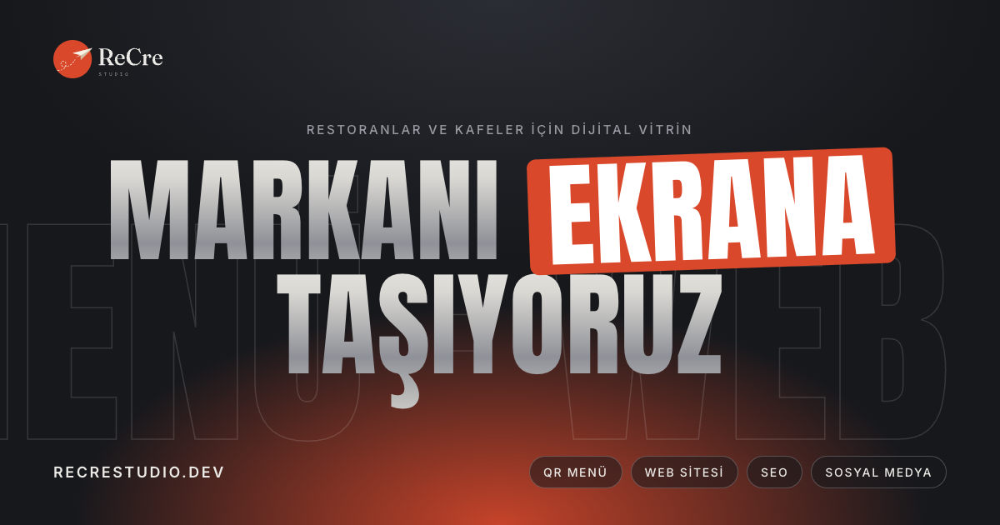

# ReCre Studio — Web Sitesi

**Canlı site:** https://recrestudio.dev

Restoranlar, kafeler ve yerel markalar için QR menü, web sitesi, SEO ve sosyal medya hizmeti veren
ReCre Studio'nun sitesi. Beş sayfa: Ana Sayfa, Hizmetler (paketler ve fiyatlar), İşler, Hakkımızda, İletişim
(teklif ve ücretsiz dijital karne formu).



## Teknoloji

- [Astro](https://astro.build) 7, statik sayfalar; tarayıcıya giden JavaScript yalnızca menü, filtre ve form için
- [`@astrojs/vercel`](https://docs.astro.build/en/guides/integrations-guide/vercel/) — iletişim formu tek bir Vercel işlevi (`/api/talep`)
- [Resend](https://resend.com) — form talebini e-posta olarak iletir
- Görseller Astro'nun görsel hattında AVIF/WebP'ye çevrilir; yazı tipleri (Anton, Inter) sitenin kendisinden yüklenir

## Yerelde çalıştırma

```sh
npm install
npm run dev        # http://localhost:4321
npm run build      # çıktı: .vercel/output/static (+ form işlevi)
npm run check      # tip denetimi
```

Yerelde `RESEND_API_KEY` yoksa form e-posta göndermez, talebi konsola yazar.
Adresin sonuna `?izgara` eklenirse 12 sütunluk hiza ızgarası görünür.

## Yapı

| Yol | İçerik |
| --- | --- |
| `src/pages/` | Sayfalar, `api/talep.ts` (form), `sitemap.xml.ts`, `404.astro` |
| `src/components/` | Menü, alt bilgi, sayfa başı; `ana/` ana sayfa bölümleri |
| `src/data/` | Site bilgileri, paketler ve fiyatlar (`paketler.ts`), işler (`isler.ts`) |
| `src/styles/` | Renk ve yazı değişkenleri (`global.css`), yazı tipleri (`fonts.css`) |
| `src/fonts/` | Anton ve Inter; Türkçe ek harfler ayrı küçük dosyalarda (nasıl üretildiği `fonts.css`'te) |
| `src/assets/` | Logo, portre ve iş görselleri |
| `public/` | Favicon, paylaşım görseli, `robots.txt` |
| `ui/`, `fonts/` | Eski web kimliği kılavuzunun ortak dosyaları (siteye dahil değil) |

## Yayın

`main` dalına yapılan her push Vercel'de otomatik olarak yayınlanır. Vercel ortam değişkenleri:

| Değişken | Gerekli | Açıklama |
| --- | --- | --- |
| `RESEND_API_KEY` | Evet | Form e-postası için |
| `TALEP_ALICI` | Hayır | Talebin gideceği adres (varsayılan recrestudio0@gmail.com) |
| `TALEP_GONDEREN` | Hayır | Gönderen (varsayılan `ReCre Site <site@recrestudio.dev>`) |

## İletişim

recrestudio0@gmail.com · Instagram [@recre_studio](https://instagram.com/recre_studio)

## Lisans

Kod ve marka varlıkları (logo, görseller) ReCre Studio'ya aittir; tüm hakları saklıdır.
Anton ve Inter yazı tipleri SIL Open Font License ile dağıtılır.
